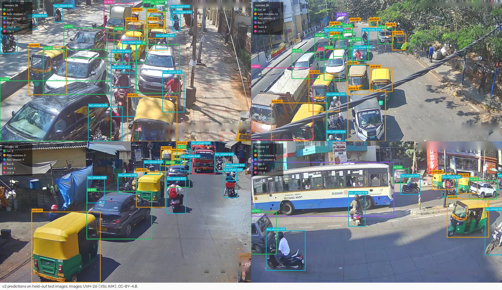
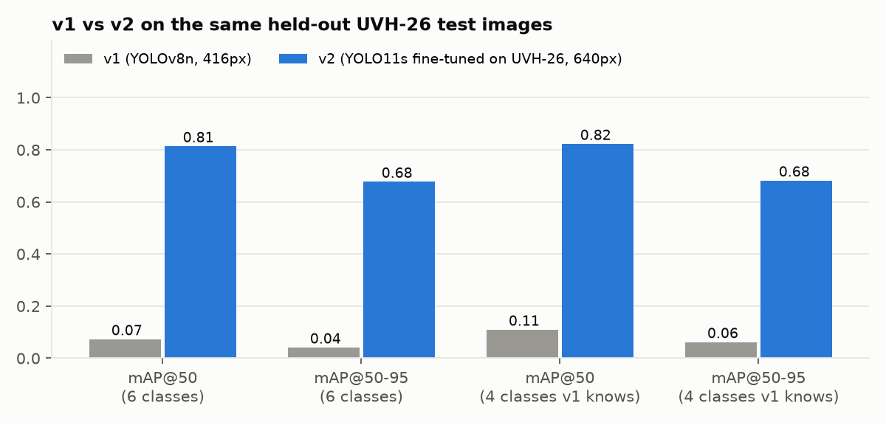
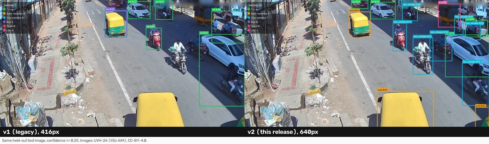
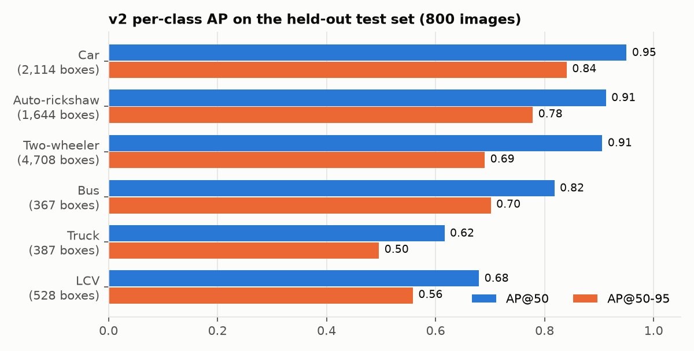
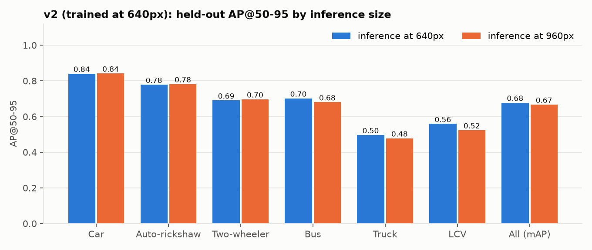
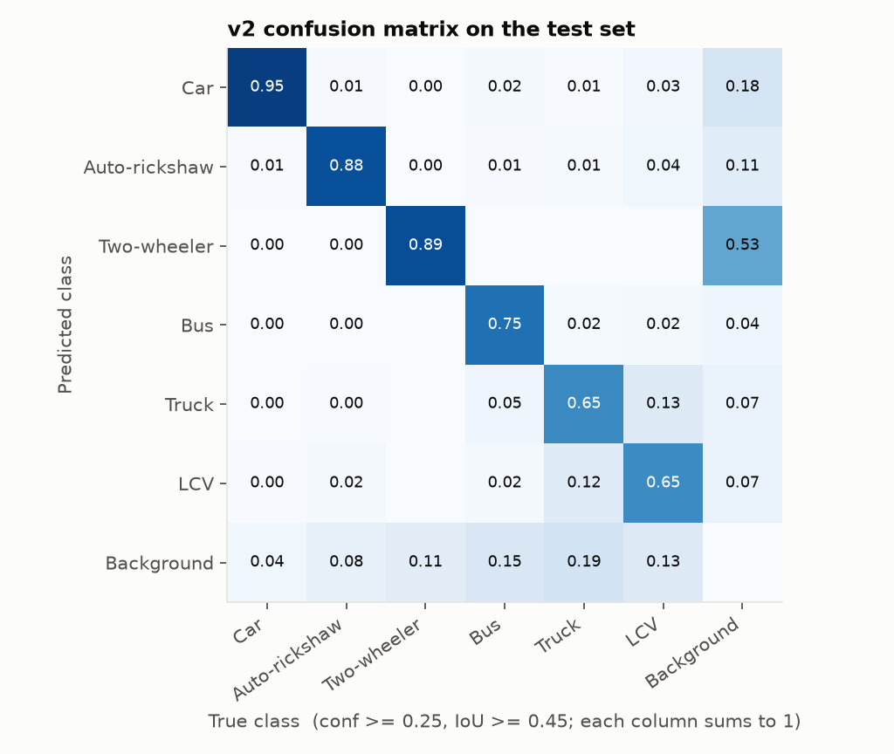
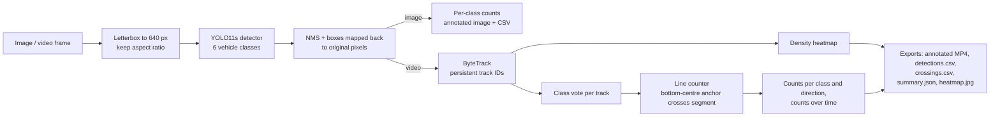
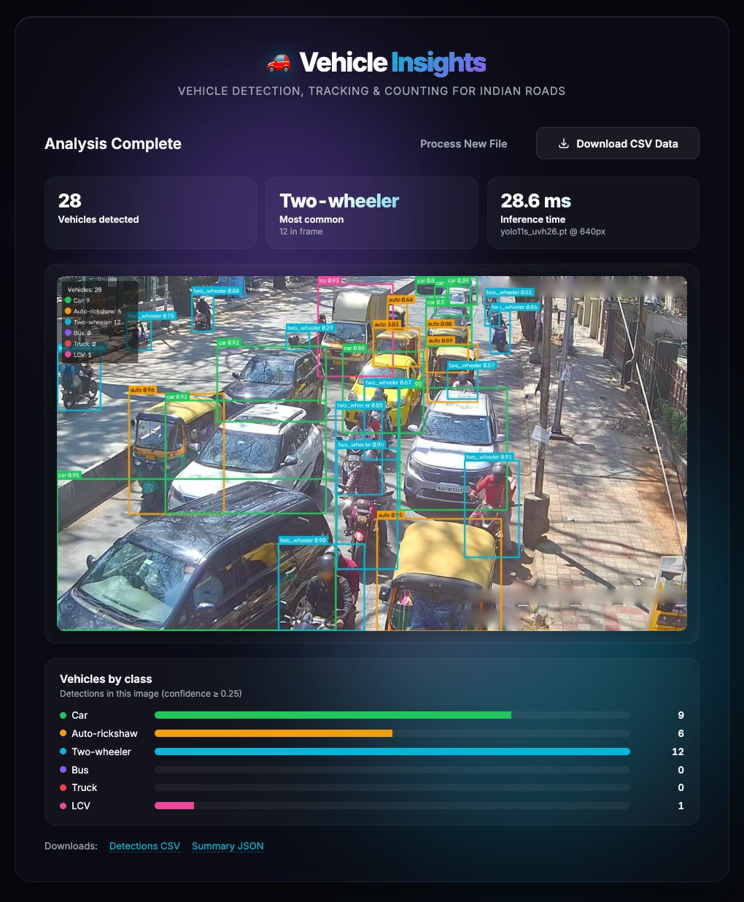
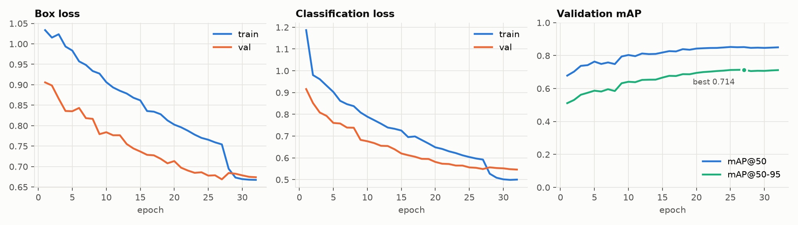

# Indian Traffic YOLO

**Detect, track and count vehicles on Indian roads** (cars, auto-rickshaws, two-wheelers, buses, trucks and LCVs) with a YOLO11 model fine-tuned on Bengaluru CCTV footage, ByteTrack tracking, virtual counting lines, and a small web app.

[](https://github.com/5upernova4/indian-traffic-yolo/actions/workflows/tests.yml)




<sub>v2 predictions on held-out UVH-26 test images. Images: [UVH-26](https://huggingface.co/datasets/iisc-aim/UVH-26) by IISc AIM, CC-BY-4.0.</sub>

## Results

All numbers come from the **held-out test set**: 800 images and 9,748 boxes sampled from the *official UVH-26 validation split*, which was never used for training or model selection. v1 and v2 are scored by the same evaluator (`traffic_yolo/evaluate.py`), using single-label predictions exactly as the app produces them. v1's five classes are mapped into the six v2 classes first (Motorcycle to two_wheeler, Ambulance ignored).

| Model | Input | mAP@50 | mAP@50-95 | Precision | Recall | Latency per 1280x720 frame (Apple M5) |
|---|---:|---:|---:|---:|---:|---|
| v1: legacy YOLOv8n, 5 classes remapped | 416 | 0.073 | 0.041 | 0.269 | 0.087 | 10.4 ms (ONNX, CPU) |
| **v2: YOLO11s fine-tuned on UVH-26 (default)** | **640** | **0.814** | **0.678** | 0.803 | 0.763 | **12.2 ms (MPS)**, 23.5 ms (ONNX, CPU) |
| v2 at a larger inference size | 960 | 0.808 | 0.667 | 0.788 | 0.762 | 19.3 ms (MPS), 48.6 ms (ONNX, CPU) |

Measured on the 4 classes v1 can express (car, two-wheeler, bus, truck), v1 scores mAP@50 0.110 / mAP@50-95 0.062, against v2's 0.823 / 0.682. **v1 performs poorly on this data, and the main reason is domain.** Its ONNX metadata says it is a YOLOv8n trained on a Kaggle "VehiclesDetectionDataset" with classes `Ambulance, Bus, Car, Motorcycle, Truck`. It has no auto-rickshaw or LCV class, and on Indian CCTV frames it finds only about 2 % of two-wheelers (recall 0.016). At confidence 0.25 it labels 250 of the 1,644 autos as cars and misses 1,359 of them entirely. That makes v1 a reasonable demo model, but not one for this setting.





### Per class (v2)

| Class | Test boxes | AP@50 (640) | AP@50-95 (640) | AP@50-95 (960) | Precision (640) | Recall (640) | v1 AP@50 |
|---|---:|---:|---:|---:|---:|---:|---:|
| Car | 2,114 | 0.950 | 0.841 | 0.842 | 0.879 | 0.921 | 0.316 |
| Auto-rickshaw | 1,644 | 0.913 | 0.778 | **0.782** | 0.901 | 0.848 | 0.000 |
| Two-wheeler | 4,708 | 0.906 | 0.690 | **0.697** | 0.867 | 0.821 | 0.049 |
| Bus | 367 | 0.818 | 0.701 | 0.680 | 0.840 | 0.747 | 0.045 |
| Truck | 387 | 0.616 | 0.496 | 0.478 | 0.615 | 0.615 | 0.029 |
| LCV | 528 | 0.680 | 0.558 | 0.523 | 0.719 | 0.629 | 0.000 |
| **All** | **9,748** | **0.814** | **0.678** | 0.667 | 0.803 | 0.763 | 0.073 |



**Inference size: 640 vs 960.** The model was trained at 640 px, and 640 is the shipped default because it is better overall (mAP@50-95 0.678 vs 0.667) and 1.6x (MPS) to 2x (CPU) faster. Running at 960 px helps exactly where you would expect, on the **smallest objects** (in the 1280x720 test frames, the median box side is about 68 px for two-wheelers and 79 px for autos, against 100-160 px for the other classes): two-wheelers go from 0.690 to 0.697 AP@50-95 (recall 0.821 to 0.842) and autos from 0.778 to 0.782. It hurts the large classes, though (bus, truck and LCV), which the model only ever saw at 640-px scale. If your footage is wide-angle and mostly two-wheelers, try `--imgsz 960`.



**Where it goes wrong.** The weakest pair is **truck vs LCV**: 12 % of true trucks are predicted as LCV, and 13 % of true LCVs are predicted as trucks. The UVH-26 definitions of the two classes overlap, and both are relatively rare (4 % and 5.5 % of training boxes). Cars, autos and two-wheelers are rarely confused with each other. Most errors are misses or false alarms against the background. At confidence 0.25, about half of all false positives are two-wheelers, the most frequent and smallest class.



<details>
<summary>Why <code>yolo val</code> reports a higher number (0.837 / 0.701)</summary>

Ultralytics' built-in validator on the same test split gives mAP@50 0.837 / mAP@50-95 0.701 (`docs/metrics/test_v2_ultralytics.json`). The difference is that `yolo val` runs NMS in *multi-label* mode: one box can be counted under several classes, which raises AP but is not what `predict` or this app outputs. When I re-ran the same validator with multi-label switched off, it gave 0.815 / 0.683, in line with the 0.814 / 0.678 above. This README reports the single-label numbers.
</details>

### Speed

Measured on an Apple M5 (10-core CPU, 16 GB) with 200 real 1280x720 test frames, batch 1, after warm-up (`scripts/benchmark.py`, `docs/metrics/speed.json`). Wall-clock end to end, including pre-processing, inference, NMS and copying boxes back to the CPU:

| Model / runtime | Input | ms / frame | FPS |
|---|---:|---:|---:|
| v2 `.pt`, PyTorch MPS | 640 | 12.2 | 82 |
| v2 `.pt`, PyTorch MPS | 960 | 19.3 | 52 |
| v2 `.onnx`, ONNX Runtime CPU | 640 | 23.5 | 43 |
| v2 `.onnx`, ONNX Runtime CPU | 960 | 48.6 | 21 |
| v1 `.onnx`, ONNX Runtime CPU | 416 | 10.4 | 96 |

On MPS, the GPU runs asynchronously, so Ultralytics' own per-stage timer puts most of the time under "post-process". Only the end-to-end column is meaningful there. Tracking, drawing and video encoding add overhead on top of this. On a synthetic 960x540 test clip, `track-count` ran at 30-45 FPS on MPS with the video export switched on.

## How it works



* **Detection.** Ultralytics handles letterboxing and maps boxes back to the original frame, so there is no hand-written rescaling (the v1 app squashed every frame to 416x416, which distorted the aspect ratio and needed a heuristic to undo it).
* **Tracking.** ByteTrack (`bytetrack.yaml`) gives each vehicle a persistent ID. Because the detector sometimes wavers between look-alike classes (LCV vs truck, say), each track's class is a confidence-weighted vote over its whole history.
* **Counting.** A vehicle is counted when the bottom-centre of its box (roughly where it touches the road) moves from one side of a counting segment to the other, *and* the crossing point lies on the segment itself, not on its infinite extension. Each track is counted at most once per line. For a line drawn left to right, `in` means the vehicle moved down the frame and `out` means it moved up. Any number of lines is supported.
* **Analytics.** Per-class counts per direction, unique vehicles per class, average vehicles in view per second, and a density heatmap of where vehicles were. All of it is exported as CSV/JSON.

## Quickstart

```bash
git clone https://github.com/5upernova4/indian-traffic-yolo.git
cd indian-traffic-yolo
python -m venv .venv && source .venv/bin/activate   # or: uv venv && source .venv/bin/activate
pip install -r requirements.txt
```

The trained weights ship in `weights/` (PyTorch `.pt` and ONNX; see the [model card](weights/README.md)), so nothing else needs downloading.

**Detect vehicles in an image or a folder**

```bash
python -m traffic_yolo predict docs/samples/519469.jpg --out runs/predict
# -> runs/predict/annotated.jpg, detections.csv, summary.json
```

**Track and count vehicles in a video**

```bash
# default: one horizontal counting line at 60 % of the frame height
python -m traffic_yolo track-count my_traffic.mp4 --out runs/track

# custom lines: x1,y1,x2,y2 as fractions of the frame (or pixels); repeat --line for more
python -m traffic_yolo track-count my_traffic.mp4 --line 0,0.55,1,0.55 --line 0.5,0,0.5,1

# CPU-only machine: use the ONNX model and run the detector on every 2nd frame
python -m traffic_yolo track-count my_traffic.mp4 --weights weights/yolo11s_uvh26.onnx --stride 2
```

Outputs: `annotated.mp4` (boxes, track IDs, trails, line counters, totals panel), `detections.csv` (one row per box per frame, with track ID), `crossings.csv` (one row per counted vehicle: line, class, direction, time), `summary.json` (counts per class and direction, unique vehicles, timeline), and `heatmap.jpg`.

**Evaluate on any YOLO-format split**

```bash
python -m traffic_yolo evaluate path/to/images/test --save metrics.json
python -m traffic_yolo evaluate path/to/images/test --weights weights/v1_legacy.onnx   # v1, remapped to the 6 classes
```

**Web app**

```bash
python app.py            # http://127.0.0.1:5000
```

Drop in an image or a video. Pick where the counting line goes (horizontal or vertical, and how far across), and you get the annotated media, headline stats, per-class counts (split by direction for videos), a chart of vehicles over time, the density heatmap, and CSV/JSON downloads. Environment variables: `TRAFFIC_YOLO_WEIGHTS` (e.g. the `.onnx` file), `FRAME_STRIDE` (run the detector on every Nth frame), `PORT`.



## Dataset and class mapping

Training data is a reproducible subset of **[UVH-26](https://huggingface.co/datasets/iisc-aim/UVH-26)** (Urban Vision Hackathon dataset, IISc AIM): 1080p frames from about 2,800 Bengaluru Safe-City CCTV cameras, with crowd-sourced boxes for 14 fine-grained vehicle classes. I used the majority-vote (`MV`) annotations.

| Split used here | Source | Images | Purpose |
|---|---|---:|---|
| train | official *train*, seeded random sample | 3,570 | training |
| val | official *train*, same sample, held apart | 630 | model selection, early stopping |
| **test** | official ***val***, seeded random sample | **800** | **held-out numbers in this README** |

The exact image lists (seed 26) are in [`docs/data_manifest.json`](docs/data_manifest.json), and `scripts/prepare_uvh26.py` rebuilds the dataset from them. Images were downscaled to 1280x720 JPEG. The test images come from the official validation split, which was never used for training or model selection.

The 14 UVH-26 classes are merged into 6 classes that match how people usually describe Indian traffic:

| v2 class | UVH-26 classes |
|---|---|
| `car` | Hatchback, Sedan, SUV, MUV, Van |
| `auto` | Three-wheeler |
| `two_wheeler` | Two-wheeler, Bicycle |
| `bus` | Bus, Mini-bus, Tempo-traveller |
| `truck` | Truck |
| `lcv` | LCV (light commercial vehicle) |
| *(dropped)* | Other (0.1 % of boxes) |

Instances per split after mapping (boxes):

| Split | car | auto | two_wheeler | bus | truck | lcv | total |
|---|---:|---:|---:|---:|---:|---:|---:|
| train | 9,196 | 7,170 | 20,655 | 1,679 | 1,750 | 2,351 | 42,801 |
| val | 1,542 | 1,168 | 3,527 | 223 | 314 | 385 | 7,159 |
| test | 2,114 | 1,644 | 4,708 | 367 | 387 | 528 | 9,748 |

**Attribution.** UVH-26 is licensed [CC-BY-4.0](https://creativecommons.org/licenses/by/4.0/). The sample images in `docs/samples/` and every image-based figure in `docs/figures/` are derived from UVH-26 (downscaled and annotated). If you use the data, please cite:

```bibtex
@techreport{sharma2025uvh26,
  title       = {Towards Image Annotations and Accurate Vision Models for Indian Traffic, Preliminary Dataset Release, UVH-26-v1.0},
  author      = {Akash Sharma and Chinmay Mhatre and Sankalp Gawali and Ruthvik Bokkasam and Brij Kishore and Vishwajeet Pattanaik and Tarun Rambha and Abdul R. Pinjari and Vijay Kovvali and Anirban Chakraborty and Punit Rathore and Raghu Krishnapuram and Yogesh Simmhan},
  institution = {Indian Institute of Science},
  type        = {Technical Report},
  number      = {arXiv:2511.02563},
  year        = {2025},
  month       = {November},
  doi         = {10.48550/arXiv.2511.02563}
}
```

## Reproducing the model

```bash
# 1. download + convert the subset (about 5,000 PNGs streamed and converted one by one; about 1.5 GB on disk afterwards)
python scripts/prepare_uvh26.py --out ../_data/uvh26   # resumable; rerun to retry failed downloads

# 2. fine-tune YOLO11s (Apple-silicon MPS, CUDA or CPU picked automatically)
python scripts/train.py --data ../_data/uvh26/yolo/dataset.yaml   # defaults: yolo11s.pt, 32 epochs, imgsz 640, batch 8, workers 2

# 3. export, evaluate v1 vs v2 on the held-out test split, benchmark, and draw the figures
cp runs/train/yolo11s_uvh26_640/weights/best.pt weights/yolo11s_uvh26.pt
yolo export model=weights/yolo11s_uvh26.pt format=onnx dynamic=True simplify=True imgsz=640
python scripts/compare_models.py --data ../_data/uvh26/yolo
python scripts/benchmark.py --images ../_data/uvh26/yolo/images/test
python scripts/make_figures.py --run runs/train/yolo11s_uvh26_640 --data ../_data/uvh26/yolo \
    --samples 519469.jpg 321741.jpg 826135.jpg 870812.jpg --compare-sample 308639.jpg
```

### Training details

* **Model:** YOLO11s (9.4 M parameters), initialised from the COCO-pretrained `yolo11s.pt`.
* **Schedule:** 32 epochs at **imgsz 640**, batch 8, **2 dataloader workers**, AdamW (lr 0.001, picked automatically by Ultralytics) with a cosine schedule, early-stopping patience 10 (never triggered). The best checkpoint is from epoch 27: val mAP@50 0.852, mAP@50-95 0.714. These are the `scripts/train.py` defaults; the fully resolved config is in [`docs/metrics/train_args.yaml`](docs/metrics/train_args.yaml) and the per-epoch log in [`docs/metrics/training_results.csv`](docs/metrics/training_results.csv).
* **Augmentation:** Ultralytics defaults (mosaic, switched off for the last 5 epochs; HSV jitter; scale 0.5; translate 0.1; horizontal flip) plus mixup 0.05. No rotation or vertical flips, because CCTV cameras are upright.
* **Hardware and time:** Apple M5, 16 GB, PyTorch MPS. Training took 3.2 h (11,427 s). A first attempt at 960 px with 8 workers needed about 13 GB of GPU memory plus swap on this 16 GB machine, so it was stopped after one epoch and training restarted at 640 px.



## Project structure

```
indian-traffic-yolo/
├── app.py                    # Flask web app (upload, background job, progress polling)
├── templates/ static/        # web UI
├── traffic_yolo/
│   ├── __main__.py           # CLI: predict | track-count | evaluate
│   ├── pipeline.py           # Detector wrapper, image + video pipelines
│   ├── counting.py           # line-crossing counter, per-track class vote
│   ├── analytics.py          # counts over time, heatmap, CSV/JSON export
│   ├── evaluate.py           # model-agnostic mAP / per-class AP / confusion matrix
│   ├── classes.py            # 6-class taxonomy + UVH-26 and v1 label mappings
│   ├── data.py               # COCO -> YOLO conversion, seeded sampling and splits
│   ├── viz.py, video.py      # drawing, browser-friendly MP4 writing
├── scripts/                  # prepare_uvh26, train, compare_models, benchmark, make_figures, make_synthetic_clip
├── weights/
│   ├── README.md             # model card
│   ├── yolo11s_uvh26.pt      # v2 (PyTorch)
│   ├── yolo11s_uvh26.onnx    # v2 (ONNX, dynamic input)
│   └── v1_legacy.onnx        # original v1 model, kept for comparison
├── docs/                     # figures, metrics JSON, data manifest, sample images
└── tests/                    # pytest: conversion, class mapping, counting, metrics, model smoke test
```

## Changelog: v1 to v2

**v1** (the original "Vehicle Insights" app by Akshat Agrawal) was a Flask app: upload an image or video, run a YOLO ONNX model in a background thread with live progress polling, and get back an annotated file plus a detections CSV. v2 keeps that app's design, structure and background-job flow, and changes the following:

* **Model.** v1's ONNX file holds a YOLOv8n with *five* classes (`Ambulance, Bus, Car, Motorcycle, Truck`, read from its metadata), even though the app's code listed eight. v2 is a YOLO11s fine-tuned on Indian CCTV data with six classes, including **autos** and **LCVs**, which v1 could not detect.
* **Correct geometry.** v1 resized frames to 416x416 (distorting the aspect ratio) and rescaled boxes by hand, using a heuristic to guess whether they were normalised. v2 lets Ultralytics letterbox the frame and map boxes back.
* **Tracking and counting.** New: ByteTrack IDs, configurable counting lines, per-class and per-direction counts, class voting per track, motion trails, a heatmap, and counts over time.
* **App.** Results dashboard (stats, per-class bars, timeline chart, heatmap tab), counting-line controls, more downloads (crossings CSV, summary JSON), upload validation, one job at a time on the GPU.
* **Engineering.** Reusable `traffic_yolo` package and CLI, a reproducible data pipeline, an honest held-out evaluation, unit tests and CI.

## Limitations

* **One city, daytime, CCTV viewpoint.** UVH-26 is Bengaluru Safe-City cameras, filmed 06:00-18:00 in February 2025. Night, rain, highway, dash-cam and drone footage are untested and will probably be worse.
* **Small slice of the data, small model.** v2 was trained on 3,570 images, with 630 more for validation (together about 20 % of the official UVH-26 train split), for 32 epochs at 640 px, limited by download bandwidth and a 16 GB laptop. Training on the full split, a larger model (YOLO11m/l), or a longer schedule should all help, especially for trucks and LCVs.
* **Truck vs LCV** is the weakest distinction (AP@50-95 0.50 and 0.56). If you only need "heavy vehicle" counts, merge the two classes.
* **Counting accuracy has not been benchmarked.** No ground-truth traffic video with counts was available for this project, so the tracker and counting line were checked with unit tests and a *synthetic* clip (a slow pan over a still test image, generated by `scripts/make_synthetic_clip.py`). Real-world counts depend on tracking quality. A vehicle that is occluded or gets a new track ID right at the line can be missed, or very occasionally counted twice. Before you rely on the numbers, check them against a manual count on your own footage.
* **Labels are crowd-sourced** (a majority vote of student annotators), so some label noise is unavoidable, and that puts a ceiling on measured precision and recall.
* The ONNX export is FP32 (38 MB). INT8 or FP16 quantisation would make it smaller and faster on CPU, but it has not been evaluated here.

## License

Code: MIT, Copyright (c) 2026 Akshat Agrawal (see [LICENSE](LICENSE)). The YOLO11 base weights and the Ultralytics library are AGPL-3.0, so the fine-tuned weights and any service built on them fall under Ultralytics' licensing terms. Dataset and dataset-derived images: CC-BY-4.0, by IISc AIM (see above).
